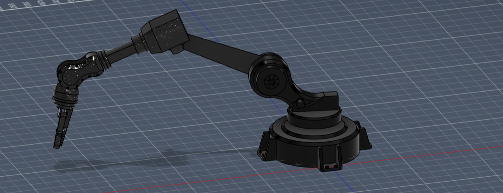
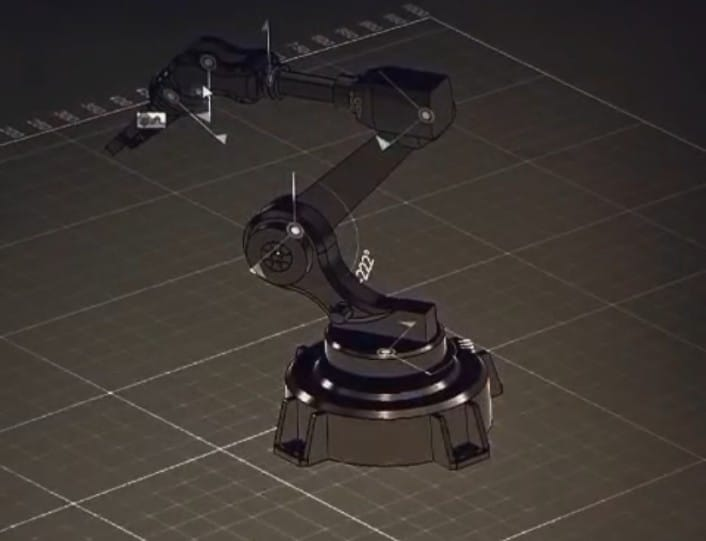

# 6DOF Industrial Robotic Arm

A six axis industrial robotic arm designed in Autodesk Fusion 360 during an internship at Softnexis.

## Overview

The arm follows the structure of an industrial manipulator, with a rotating base, shoulder, elbow and a three axis wrist. Joints are defined in the assembly so the motion of each axis can be studied directly in the CAD environment.

## Specifications

| Item | Detail |
|---|---|
| Degrees of freedom | 6 |
| Joint type | Revolute |
| Software | Autodesk Fusion 360 |
| Formats | F3Z, STEP, STL |

## Repository Contents

| Folder | Description |
|---|---|
| `cad/` | Native Fusion 360 archive (`RoboticArm6DOF.f3z`) |
| `models/` | Exchange formats: STEP for CAD software, STL for 3D printing |
| `images/` | Model views and joint axis reference |
| `media/` | Motion demonstration video |

## Joint Axes

## Opening the Model

- Fusion 360: upload `cad/RoboticArm6DOF.f3z` through the Data Panel.
- Other CAD software: import `models/RoboticArm6DOF.step`.
- Quick preview: GitHub renders `models/RoboticArm6DOF.stl` in the browser.

## Planned Work

- Structural analysis of the main load bearing links
- Motor and gearbox selection for each joint
- Inverse kinematics implementation in Python

## Author

Zain Haider, Hardware and Robotics Engineer. Co founder of Robetix and founder of [Nvisco](https://nvisco.com).
